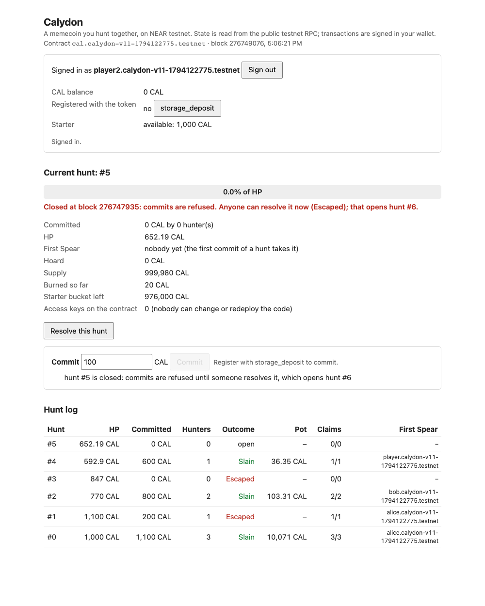
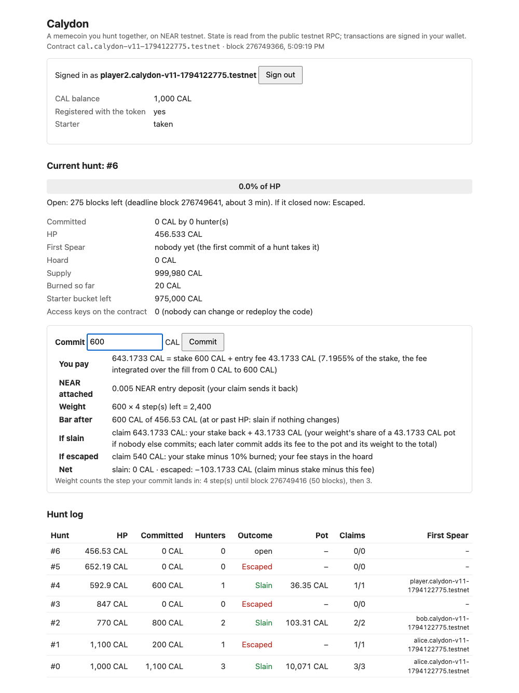
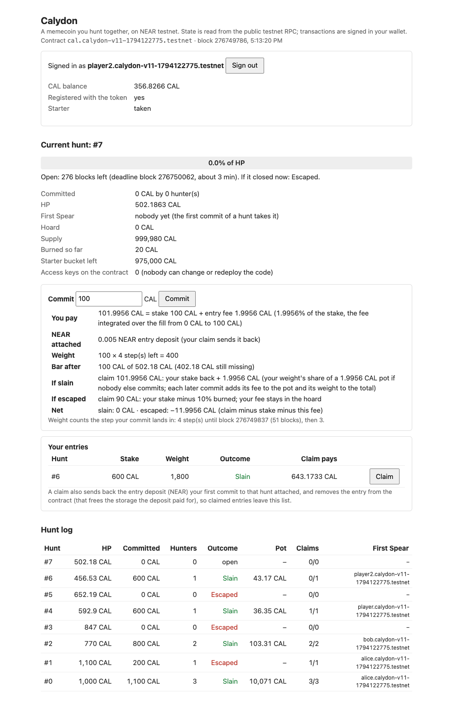

# Calydon

A memecoin you hunt together, on NEAR. Holders lock their own CAL against a beast's HP before a
deadline. If the total reaches the HP, the beast is slain and the hunters share the hoard. If it
falls short, the beast escapes with 10% of every stake, and that 10% burns.

Status: **v1.1, NEAR testnet only.** The v1.1 instance
[`cal.calydon-v11-1794122775.testnet`](https://testnet.nearblocks.io/address/cal.calydon-v11-1794122775.testnet)
was created, deployed and initialised in **one transaction** and has **never had an access key**, so
no transaction can be signed as that account and its code cannot be replaced. Its code hash equals
`res/calydon.wasm`, which `npm run verify:reproducible` rebuilds byte for byte from this repository.
`npm run observe-testnet` checks all of this without any key.

**v1.0 is superseded.** The v1.0 instance `cal.calydon-v1-1794114512.testnet` (tag `v1.0`) is
immutable like every instance, so it keeps running v1.0's code; its record moved to
[testnet/v1.0/run.json](testnet/v1.0/run.json) (`node scripts/observe-testnet.mjs testnet/v1.0/run.json`
still checks it). What v1.1 changes, each with its check:

| Change | Checked by |
|---|---|
| Playable in a browser: `npm run page` with NEAR wallet sign-in, storage_deposit, starter, commit with a live preview, resolve, claim, your entries, deadline feedback | §3; one session recorded in [docs/browser/](docs/browser/) |
| A commit that creates an entry attaches 0.005 NEAR for its storage (returned by its claim); `resolve` and `starter` attach 0.005 NEAR; any call whose storage is not covered is refused; minimum stake 1 CAL. v1.0 paid storage from the contract's own NEAR, so enough tiny commits could halt it ([MECHANIC.md §5](MECHANIC.md#5-limits-stated-plainly)) | `npm run verify`, `v1_1_storage_starter_sweep` claims 2, 3, 5 |
| Supply in the contract: holder 1%, launch hoard 1%, starter bucket 98%; `starter()` gives 1,000 CAL once per registered account (demo-level) | claim 1 of the same test; the testnet record |
| `resolve` sweeps CAL sent to the contract by plain transfer into the hoard; the observer reports any surplus | claim 4; testnet hunt 1 (50 CAL swept) |
| create + deploy + `new` in one transaction (v1.0 deleted its keys afterwards) | `rule_a_hunts` claim 1; `observe-testnet` |
| First Spear: each hunt records its first committer, shown on the page | claim 5; testnet hunt log |
| Simulation: exact oracle for every fee, weight and payout, 13 seeds of the launch cell, a first-mover agent, a replicator run | §5 |

Every claim below comes with the command that checks it and the output it printed for us.
[VERIFY.md](VERIFY.md) lists each claim → command → expected output. The design, the simulation
tables and the limits are in [MECHANIC.md](MECHANIC.md).

## The rules (launch values, fixed at `new`, readable through `config()`)

| | |
|---|---|
| `starter()` | Once per registered account: 1,000 CAL from the starter bucket (980,000 CAL at launch), attaching 0.005 NEAR. Demo-level: more accounts get more starters. |
| `commit(amount)` | Locks your own CAL (at least 1 CAL) in the current hunt. The entry fee is paid on top and goes into the hoard: 1% for a token that goes into an empty bar, rising linearly to 11% for a token that goes into a full bar (and 11% past the HP); the fee is that rate integrated over the fill your stake covers. Your first commit to a hunt attaches 0.005 NEAR (the entry's storage, returned by your claim), a later one 1 yoctoNEAR. The hunt's first committer is its First Spear. |
| Reward rule B | A commit's weight is stake × the number of steps left before the deadline (4 steps per hunt on testnet). |
| `resolve(hunt)` | Anyone, once, after the deadline, attaching 0.005 NEAR (it stores the next hunt). Slain if committed ≥ HP. CAL sent to the contract by plain transfer is swept into the hoard first. |
| `claim(hunt)` | Once per hunter. Slain: stake + hoard × weight / total weight, rounded down. Escaped: stake − 10% (the 10% burns, rounded up); the hoard rolls over. Sends the entry's 0.005 NEAR back. |
| Next HP | ×1.1 after a kill, ×0.7 after an escape (equilibrium kill rate ≈ 79%). A hunt nobody joins is an escape, so the HP keeps shrinking (×0.7 each) until someone can fill it. |
| Supply | Minted once at `new` (testnet: holder 10,000, launch hoard 10,000, starter bucket 980,000 CAL); it only falls, by escape burns. `ft_transfer` / `ft_transfer_call` are plain NEP-141 with no fee. |
| Admin | None: no owner, setter, pause or upgrade method. The views are `config`, `current_hunt`, `hunt`, `entry`, `totals`, `starter_taken`. |

Why each rule exists, and the problem the rising entry fee answers: [MECHANIC.md §1–2](MECHANIC.md).

## 1. Check the contract in one command → see every claim `HELD`

Prerequisites. Both paths below were run for this repository: macOS on Apple Silicon, and a clean
`ubuntu:24.04` container following exactly these lines (@@LINUXRUN@@).

- **Debian/Ubuntu** (as root, or with `sudo`):
  ```sh
  apt-get update && apt-get install -y build-essential pkg-config libssl-dev curl ca-certificates git nodejs npm
  set -o pipefail   # bash: a failed download now fails the next line instead of running an empty script
  curl --proto '=https' --tlsv1.2 -sSf https://sh.rustup.rs | sh -s -- -y --profile minimal
  . "$HOME/.cargo/env"
  ```
  `ca-certificates` is needed for the HTTPS downloads (rustup, crates, the sandbox binary); a minimal
  image does not have it. Ubuntu 24.04's `nodejs` is 18.x, which is enough.
- **macOS**: the Xcode command line tools, `brew install pkg-config openssl node`, and rustup as above.
- `rust-toolchain.toml` makes rustup fetch Rust 1.99.1 and the wasm target on first use.
- No npm dependencies, no Docker, account, key or paid API. Docker is needed only for
  `npm run verify:reproducible` (§6), and it must run on a Docker host, not inside the container above.

```sh
git clone https://github.com/ianlyoo/calydon.git
cd calydon
npm run verify
```

`npm run verify` is `cargo test --locked -- --nocapture --test-threads=1`. It runs the unit tests
(including a 20,000-case property test for splitting) and then starts a local NEAR sandbox, deploys
the committed `res/calydon.wasm` (the bytes deployed on testnet) and asserts every claim on
contract state, balances and execution outcomes, checking conservation (I1) after every step. The
first run downloads the crates and the sandbox binary. Nothing in it touches testnet.

Expected output (abridged; @@VERIFYRUN@@):

```text
test tests::fill_fees ... ok
test tests::m2_counterexample_is_the_safe_direction ... ok
test tests::rounding_helpers ... ok
test tests::splitting_never_pays_more ... ok
test result: ok. 4 passed; 0 failed; 0 ignored; 0 measured; 0 filtered out; finished in 0.35s

test execute_testnet ... ignored, uses NEAR testnet and the faucet; run with `npm run execute-testnet`

test launch_values ... HELD  1  launch values are fixed at init and readable: rule B, tribute 1%, fill fee up to +10%, burn 10%, HP x1.1 / x0.7
HELD  2  refused commits change nothing: below the 1-CAL minimum stake, a new entry without its storage deposit, stake + fee above the balance
HELD  3  the entry fee rises with the bar's fill and goes into the hoard; rule B weights a commit by the steps left
         observed: alice 600 into an empty bar: fee 24 CAL (1% + 10% x 0.3 average fill); bob 500 at 600/1000: fee 47 CAL (400 at 1% + 10% x 0.8, 100 past HP at 11%); weights 600x4, 500x2; hoard 1000 + 71 = 1071 CAL
...
Calydon verify (launch values: R2 fee, rule B, HP x1.1/x0.7): 7 claims held, 0 broken.
ok
test rule_a_hunts ... HELD  1  every parameter is fixed at init and readable; the wasm exports no setter, admin or pause method (I4; contract_source_metadata is the sdk's read-only NEP-330 view); create + deploy + new is one transaction and the contract account has no access key
...
Calydon verify (rule A, arithmetic-test values: no fill fee, HP x1.25/x0.8): 9 claims held, 0 broken.
ok
test rule_b_and_splitting ... HELD  1  rule B: no cap; the hoard is shared by stake x steps left, so an earlier commit earns more per token
HELD  2  I3 on chain: splitting a stake of 2 into 1 + 1 does not pay more (shares round down, tributes round up)
Calydon verify (rule B and splitting, arithmetic-test values): 2 claims held, 0 broken.
ok
test v1_1_storage_starter_sweep ... HELD  1  starter(): a registered account takes 1,000 CAL once from the starter bucket; the last one gets what is left, then it is empty
HELD  2  storage: a commit that creates an entry must attach the entry deposit (5 mNEAR), a later commit to the same entry 1 yocto; the contract's free NEAR does not fall
         observed: alice's first commit added 119 bytes (with the hunt's First Spear), bob's 98 bytes = 980000000000000000000 yoctoNEAR of storage, under the 5 mNEAR attached; [...] free NEAR 2197520000000000000000000 -> 2205350000000000000000001 yocto
HELD  3  the halt scenario: storage growth that the attached NEAR does not cover is refused, so commits cannot spend the contract's own NEAR
         observed: instance with entry_deposit = 1 yocto: first commit panics STORAGE_NOT_COVERED; no entry stored; contract free NEAR not lower
HELD  4  a plain transfer to the contract (77 CAL) shows as held - parts; resolve sweeps it into the hoard, so the identity holds again and it is paid out with the pot
HELD  5  claim pays the CAL and sends the 5 mNEAR entry deposit back; First Spear of hunt 0 is alice, the first to commit
         observed: alice claimed 454.7352 CAL and her NEAR rose by 0.004481 (5 mNEAR minus gas); first_spear = "alice.test.near"; [...]
Calydon verify (v1.1 storage, starter, sweep): 5 claims held, 0 broken.
ok

test result: ok. 4 passed; 0 failed; 0 ignored; 0 measured; 0 filtered out; finished in 110.19s
```

`rule_a_hunts` and `rule_b_and_splitting` run the same wasm with arithmetic-test values (no fill fee,
HP ×1.25 / ×0.8) so each payout can be checked by hand; `launch_values` and
`v1_1_storage_starter_sweep` run the launch values. The full list of claims and their `observed:`
lines: [VERIFY.md §A](VERIFY.md#a-npm-run-verify-local-sandbox-no-account-or-key).

## 2. Check the live testnet instance → see `All 5 checks hold`

```sh
npm run observe-testnet
```

Read-only, Node only, no key. It reads [testnet/run.json](testnet/run.json) (the recorded v1.1 run)
and asks the public testnet RPC. Output on @@OBSDATE@@ (the latest hunt is open or waiting to be
resolved whenever you run it; anyone may resolve it):

```text
Calydon v1.1 on NEAR testnet: cal.calydon-v11-1794122775.testnet

OK    deployed code = res/calydon.wasm (the reproducible build; rebuild it with npm run verify:reproducible)
      chain code_hash 21jLBW4mzWYK1oW2bV2HTC7yRPaKS6MMmr5NjaUxAgpt; res/calydon.wasm sha256 0f0b8ce7b02ca03d1edf1d4e0053a198f880cd1131e8dbaf288a0594ee15754d
      NEP-330 on chain: git+https://github.com/ianlyoo/calydon?rev=9000bcf84cbe5d0fb0b94a85c27cb3da21812556, image docker.io/library/rust:1.99.1-slim-bookworm
OK    the contract account was created, deployed and initialised in one transaction with no key, and has 0 access keys now (no redeploy, no admin call)
      init tx 2rTsy5KCJjw3KFJsBdTCHL9M1TSrNSva741uQPAgnwDp actions: CreateAccount, Transfer, DeployContract, FunctionCall(new); view_access_key_list: 0 keys
OK    config() = the launch values recorded at init
      rule EarlyWeight, tribute 100 bps + fill fee up to 1000 bps, burn 1000 bps, HP x1.1 slain / x0.7 escaped, hunts of 300 blocks
OK    all 23 recorded transactions succeeded on chain with the recorded return values
      23 of 23, e.g. https://testnet.nearblocks.io/txns/3FZN7r2b6dvJoeqvKnTcb37yC3mMCWMpbWbn1d4sKJEv
OK    totals: held >= hoard + locked + unclaimed + starter bucket (surplus reported); supply + burned = launched
      supply 999980 CAL, burned 20, hoard 0, locked 0, unclaimed 0, starter bucket 976000; surplus 0 CAL

Hunt log:
  hunt 0: HP 1000 CAL, committed 1100 by 3, Slain, pot 10071 CAL, claims 3/3, First Spear alice.calydon-v11-1794122775.testnet
  hunt 1: HP 1100 CAL, committed 200 by 1, Escaped, claims 1/1, First Spear alice.calydon-v11-1794122775.testnet
  hunt 2: HP 770 CAL, committed 800 by 2, Slain, pot 103.318181 CAL, claims 2/2, First Spear bob.calydon-v11-1794122775.testnet
  hunt 3: HP 847 CAL, committed 0 by 0, Escaped, claims 0/0
  hunt 4: HP 592.9 CAL, committed 600 by 1, Slain, pot 36.355 CAL, claims 1/1, First Spear player.calydon-v11-1794122775.testnet
  hunt 5: HP 652.19 CAL, committed 0 by 0, deadline passed, not resolved yet, claims 0/0

All 5 checks hold.
```

Hunt 4 is the browser session of §3. The scripts try the public FastNEAR archival RPC, then
`test.rpc.fastnear.com`, then `archival-rpc.testnet.near.org`; `CALYDON_TESTNET_RPC=<url>` replaces
that list (and the RPC of the CLI, whose default is `https://test.rpc.fastnear.com`).

### The recorded testnet run

`npm run execute-testnet` produced [testnet/run.json](testnet/run.json) on 2026-11-08 (16:35 KST):
a fresh faucet account `calydon-v11-1794122775.testnet` is the launch holder (10,000 CAL),
`cal.<it>` runs the contract, and three hunters register and take their starters. Each fee and
payout was checked against the contract's arithmetic (`fill_fee`, `share`) before it was recorded.

| Step | Returned | Transaction |
|---|---|---|
| create + deploy + `new` in one transaction | – | [2rTsy5KC…](https://testnet.nearblocks.io/txns/2rTsy5KCJjw3KFJsBdTCHL9M1TSrNSva741uQPAgnwDp) |
| storage_deposit alice | registered | [J9KvNpwY…](https://testnet.nearblocks.io/txns/J9KvNpwY4dfo7QhSMUEpHHELiyxgSpbJenPpYvXsiizo) |
| starter alice | 1,000 CAL | [Cui5u13m…](https://testnet.nearblocks.io/txns/Cui5u13mbCztFV4gAQGrU138ufPqWz5T8Zrq4f9Ytcnx) |
| storage_deposit bob | registered | [48aX6nJY…](https://testnet.nearblocks.io/txns/48aX6nJYpCD1L94UFxZyE82YNSLhdL38r8zj3zHmWmKS) |
| starter bob | 1,000 CAL | [FTUG4XiA…](https://testnet.nearblocks.io/txns/FTUG4XiAS3KHNFousXAk3T5JWJr9DginGi7CNXPeh8wF) |
| storage_deposit carol | registered | [3wsdPwFE…](https://testnet.nearblocks.io/txns/3wsdPwFEtXqVkm9dGTzzUXcpmZxRFVWx9vMZA8iNpHWC) |
| starter carol | 1,000 CAL | [GUfQ9gQn…](https://testnet.nearblocks.io/txns/GUfQ9gQnYGoP8QFmoVvCcFpMpYrYCUy3sW3Z3YYYWSY6) |
| hunt 0: alice commit 400 CAL (bar 0/1000 CAL, fee 12.0000 CAL) | 400 CAL locked | [DbDx6ZLf…](https://testnet.nearblocks.io/txns/DbDx6ZLfLtLXeqov542QhMMpzKwVU6CG3G2a2Vbnd8U4) |
| hunt 0: bob commit 300 CAL (bar 400/1000 CAL, fee 19.5000 CAL) | 300 CAL locked | [2pB9oqvQ…](https://testnet.nearblocks.io/txns/2pB9oqvQzVrPhxFj5JyBmLfLSsYqsosFtJhnxUP3JPuw) |
| hunt 0: carol commit 400 CAL (bar 700/1000 CAL, fee 39.5000 CAL) | 400 CAL locked | [B6MjPWKW…](https://testnet.nearblocks.io/txns/B6MjPWKWy7uku6pbE57AnzwqetR1yXEyCcGokxB33JM6) |
| hunt 0: resolve | `Slain` | [3FZN7r2b…](https://testnet.nearblocks.io/txns/3FZN7r2b6dvJoeqvKnTcb37yC3mMCWMpbWbn1d4sKJEv) |
| hunt 0: alice claim | 4,062.181818… CAL | [HPMzKZtP…](https://testnet.nearblocks.io/txns/HPMzKZtPfqNebaZ9kBupePUfLH7R2tMsbshGc1HWvMUU) |
| hunt 0: bob claim | 3,046.636363… CAL | [9UuJfqdS…](https://testnet.nearblocks.io/txns/9UuJfqdS5etoVVsfNVMxXu1xmnHEqJEbyUPugmqK85ap) |
| hunt 0: carol claim | 4,062.181818… CAL | [ncSb8TiB…](https://testnet.nearblocks.io/txns/ncSb8TiBdeHwX9bc5dzwj5uuXssktPtXWdQfNqUGSFM) |
| hunt 1: alice commit 200 CAL (bar 0/1100 CAL, fee 3.8182 CAL) | 200 CAL locked | [2EqzLwLo…](https://testnet.nearblocks.io/txns/2EqzLwLofsF33gYoGDKQDCoLbUXGksrSHdDPocfz5M8M) |
| hunt 1: holder ft_transfer 50 CAL to the contract (a plain transfer) | – | [7inQaidM…](https://testnet.nearblocks.io/txns/7inQaidML8VVMv47RYSYSqhzyz3No2SXwqD8dBZxF8Ww) |
| hunt 1: resolve (sweeps the 50 CAL into the hoard) | `Escaped` | [Anifpa1E…](https://testnet.nearblocks.io/txns/Anifpa1EbL9py728CSBEN53MHVTN9uUCGin34jmFDFVh) |
| hunt 1: alice claim | 180 CAL | [AVPa7bJD…](https://testnet.nearblocks.io/txns/AVPa7bJDLt6FePaS5ZU73Ufo3ZxfHzxDsHTqdbktjUGn) |
| hunt 2: bob commit 500 CAL (bar 0/770 CAL, fee 21.2338 CAL) | 500 CAL locked | [3W1XoS84…](https://testnet.nearblocks.io/txns/3W1XoS84eBf5x7zx2KYC1e7wntvNAonXXi91gtg6cZ7x) |
| hunt 2: carol commit 300 CAL (bar 500/770 CAL, fee 28.2662 CAL) | 300 CAL locked | [FjXg7PCw…](https://testnet.nearblocks.io/txns/FjXg7PCwXfs9jyZ7V7yvmof1LCJjsiZETjGJv7vwX85g) |
| hunt 2: resolve | `Slain` | [3hn2aVcR…](https://testnet.nearblocks.io/txns/3hn2aVcRqLC5vEfs2Xpp1BRuGJtjsohxEHMvqwYdanNe) |
| hunt 2: bob claim | 564.573863… CAL | [2uq1Sj2f…](https://testnet.nearblocks.io/txns/2uq1Sj2fQ1C9UfyP1w6W2QBgKSYbdAtKGMDyiAdwJ2xY) |
| hunt 2: carol claim | 338.744318… CAL | [DfrNzU3m…](https://testnet.nearblocks.io/txns/DfrNzU3m78B1DBKj2jHZU1vUL1FeK7BUHESegcxVFj7y) |

What the numbers show: carol's 400 CAL went in last, partly past the HP, and paid 39.5 CAL in fees
against alice's 12 CAL for the same stake into an empty bar. All three landed in the same rule-B
step, so their shares of the 10,071 CAL pot (launch hoard 10,000 + 71 in fees) are pro rata. In
hunt 1 the holder sent 50 CAL to the contract with a plain `ft_transfer`; `totals` showed it as a
50 CAL surplus until `resolve` swept it into the hoard (`sweep` event), so hunt 2's pot (103.318181
CAL) is the 50 CAL plus hunt 1's and hunt 2's fees.

## 3. Play in a browser → sign in, commit, resolve and claim from the page

```sh
npm run page
```

```text
Calydon page: http://127.0.0.1:8494/status/  (Ctrl-C to stop)
```

Open that address. `status/` is a static page (HTML, one script, and the pinned wallet bundle in
`status/vendor/`); `npm run page` only serves it and `testnet/run.json` from this machine, and the
same files can be hosted as they are. Nothing is hosted by this repository. The page reads the
public testnet RPC every 4 seconds; `?contract=<id>` shows another instance (for example one you
launched in §4) and `?rpc=<url>` uses another RPC.

**Wallet.** Sign-in uses NEAR wallet-selector 10.1.4 with the Intear Wallet module
(`@near-wallet-selector/intear-wallet`, pinned, bundled by `status/vendor-src/`). Any testnet account
works: create one in [Intear Wallet](https://wallet.intear.tech) or import one there by private key
or seed phrase. MyNearWallet is not offered: since 1 November 2026 it no longer connects to apps or
signs transactions. Every call that attaches NEAR (storage_deposit, starter, commit, resolve) opens a
wallet window to approve; so does claim.

**What the page does, signed in:** your CAL balance; a `storage_deposit` button until you are
registered; `Get starter CAL` until you took it; `Commit` with a live preview of what you pay (stake
+ the exact entry fee, integrated over the fill your stake covers), the NEAR attached, your weight
(stake × steps left), the bar after, and your claim if the hunt is slain or escaped as things stand;
`Resolve this hunt` once the deadline has passed; and *Your entries* with what each claim pays and a
`Claim` button. The deadline line says how many blocks are left, which step a commit lands in and
until which block, and turns red once commits are refused. Signed out, it shows the hunt, HP bar,
hoard, supply, burned CAL, the starter bucket, the access keys on the contract (0) and the hunt log
with each hunt's First Spear.

**One recorded session** ([docs/browser/](docs/browser/), 2026-11-08 17:03–17:14 KST): a fresh
testnet account `player2.calydon-v11-1794122775.testnet`, imported into Intear Wallet, signs in on the
page, runs `storage_deposit` ([4JDGGonj…](https://testnet.nearblocks.io/txns/4JDGGonjH4dWUZS2GJR3YjqW81MWFGPwtLPYWvjxWEqa))
and takes its starter ([6ryG5NSj…](https://testnet.nearblocks.io/txns/6ryG5NSjw21uCvDaGADaVxZu52yy6tZExrWxsw5jAiue)),
resolves the empty hunt 5 ([J76Hf4aL…](https://testnet.nearblocks.io/txns/J76Hf4aLms5S31AxeQ95uwQWeGY9qL5TqKmpurBmxhK6)),
commits 600 CAL into hunt 6 (preview: pay 643.1733 CAL = stake 600 + entry fee 43.1733, weight 600 × 4,
claim 643.1733 CAL if slain and nobody else commits;
[Hr4ftz3t…](https://testnet.nearblocks.io/txns/Hr4ftz3tj8LJj7cVyHZ6zigSqqLZb3cCbBf3SHDiiDJ5)),
waits for the deadline, resolves hunt 6 (`Slain`, it is First Spear;
[6S1NvhGb…](https://testnet.nearblocks.io/txns/6S1NvhGbdkhVM8nVtJAfczBAEyAy1ayR1tk5pJ5gLeqt)), and claims
643.1733 CAL plus the 0.005 NEAR entry deposit back
([B4rnod1h…](https://testnet.nearblocks.io/txns/B4rnod1h47Cf4bHhmHGRrUeY1XQVHQBY1sZhFuBe4L8A)).
Each step is a screenshot of the page and of the wallet window, in order. It was driven by
`scripts/browser-session.mjs` (Playwright; not a dependency of this repository).

| Signed in | Commit preview | Claimable |
|---|---|---|
|  |  |  |

## 4. Play on testnet from the command line → see your commit, the resolve and your claim as transactions

```sh
npm run hunt -- launch                     # your own instance, created like the v1.1 one
npm run hunt -- commit 600 --as alice
npm run hunt -- status
npm run hunt -- resolve                    # after the deadline; anyone may
npm run hunt -- claim 0 --as alice
npm run hunt -- starter --as <name>        # any account with a key file in .credentials/testnet/
```

`launch` creates a fresh account from the testnet faucet (free, no key or token of yours needed),
creates, deploys and initialises `cal.<it>` in one transaction with the launch values (so that
account never has a key), and creates two hunters, `alice` and `bob`, who register and take their
1,000-CAL starters. Their keys are random and saved under `.credentials/testnet/` (ignored by git;
never printed). A hunt lasts 600 blocks (about 6 minutes on testnet; `--hunt-blocks N` changes it).
Each command compiles once, then took us 30–55 seconds per call against the public RPC; a commit that
lands after the deadline is refused with `HUNT_CLOSED` and nothing moves. Without a `launch`, the
commands use the recorded v1.1 instance, where any account can take a starter and play.

Output from one session on 2026-11-08 (16:57 KST), launched with `--hunt-blocks 200`:

```text
$ npm run hunt -- launch --hunt-blocks 200
launched cal.calydon-play-1794124670.testnet (no access key); holder calydon-play-1794124670.testnet; alice and bob took 1000-CAL starters
contract cal.calydon-play-1794124670.testnet (rule EarlyWeight, tribute 100 bps + fill fee up to 1000 bps, burn 1000 bps, HP x1.1 / x0.7)
hunt 0: [....................] 0 / 1000 CAL committed by 0 hunter(s)
  open: 171 blocks left (deadline 276748416); the next 1 CAL committed pays 0.01005 CAL fee (a larger stake pays the fee integrated over the fill it covers)
hoard 10000 CAL · supply 1000000 CAL · burned 0 CAL · unclaimed 0 CAL · starter bucket 978000 CAL

$ npm run hunt -- commit 600 --as alice
alice.calydon-play-1794124670.testnet committed 600 CAL
  https://testnet.nearblocks.io/txns/91FmcjbPma59j8ng6YXfY3GFAGDfJCAmHMjbDokMWYtt
  locked 600 CAL
contract cal.calydon-play-1794124670.testnet (rule EarlyWeight, tribute 100 bps + fill fee up to 1000 bps, burn 1000 bps, HP x1.1 / x0.7)
hunt 0: [############........] 600 / 1000 CAL committed by 1 hunter(s)
  open: 102 blocks left (deadline 276748416); the next 1 CAL committed pays 0.07005 CAL fee (a larger stake pays the fee integrated over the fill it covers)
hoard 10024 CAL · supply 1000000 CAL · burned 0 CAL · unclaimed 0 CAL · starter bucket 978000 CAL

$ npm run hunt -- commit 500 --as bob
bob.calydon-play-1794124670.testnet committed 500 CAL
  https://testnet.nearblocks.io/txns/D816us4ofyDoNMPGFgdYjsui4qiJSSNZbRKmNhxUvvyY
  locked 500 CAL
contract cal.calydon-play-1794124670.testnet (rule EarlyWeight, tribute 100 bps + fill fee up to 1000 bps, burn 1000 bps, HP x1.1 / x0.7)
hunt 0: [####################] 1100 / 1000 CAL committed by 2 hunter(s)
  open: 34 blocks left (deadline 276748416); the next 1 CAL committed pays 0.11 CAL fee (a larger stake pays the fee integrated over the fill it covers)
hoard 10071 CAL · supply 1000000 CAL · burned 0 CAL · unclaimed 0 CAL · starter bucket 978000 CAL

$ npm run hunt -- status
contract cal.calydon-play-1794124670.testnet (rule EarlyWeight, tribute 100 bps + fill fee up to 1000 bps, burn 1000 bps, HP x1.1 / x0.7)
hunt 0: [####################] 1100 / 1000 CAL committed by 2 hunter(s)
  deadline 276748416 passed: `npm run hunt -- resolve` settles it (will be Slain)
hoard 10071 CAL · supply 1000000 CAL · burned 0 CAL · unclaimed 0 CAL · starter bucket 978000 CAL

$ npm run hunt -- resolve
hunt 0 resolved by calydon-play-1794124670.testnet
  https://testnet.nearblocks.io/txns/E6rrv2tmN7xGnjMkecKJvDBJNPXX8zWcvYRiBaW4Dsma
  outcome "Slain"
contract cal.calydon-play-1794124670.testnet (rule EarlyWeight, tribute 100 bps + fill fee up to 1000 bps, burn 1000 bps, HP x1.1 / x0.7)
hunt 1: [....................] 0 / 1100 CAL committed by 0 hunter(s)
  open: 198 blocks left (deadline 276748729); the next 1 CAL committed pays 0.010045454545454546 CAL fee (a larger stake pays the fee integrated over the fill it covers)
hoard 0 CAL · supply 1000000 CAL · burned 0 CAL · unclaimed 11171 CAL · starter bucket 978000 CAL

$ npm run hunt -- claim 0 --as alice
alice.calydon-play-1794124670.testnet claimed hunt 0
  https://testnet.nearblocks.io/txns/BvQnGxUGFQqbXo9wxb2bDPKjMWU2fLC64XZXAPb8tzYX
  paid 8481.65217391304347826 CAL; balance now 8857.65217391304347826 CAL

$ npm run hunt -- claim 0 --as bob
bob.calydon-play-1794124670.testnet claimed hunt 0
  https://testnet.nearblocks.io/txns/HuHvbjQ92PM9avwGBa3PrjgKFpjhJJTFYXzJDVwtvb1B
  paid 2689.347826086956521739 CAL; balance now 3142.347826086956521739 CAL
```

The pot was the 10,000 CAL launch hoard plus the two fees (24 + 47). Alice's commit landed with 3 of
4 steps left (weight 600 × 3 = 1,800) and bob's with 1 (500 × 1 = 500), so alice got 600 + 10,071 ×
1,800 / 2,300 and bob 500 + 10,071 × 500 / 2,300, rounded down. Each claim also sent back the
0.005 NEAR its first commit attached.

## 5. Re-run the simulation → see MECHANIC.md's tables

```sh
npm run simulate -- --seed 494     # about 13 minutes; writes sim/seed-494-hp300.json
npm run sim-tables                 # prints MECHANIC.md §3's tables from the files in sim/
```

300 hunters with six fixed strategies play 60 hunts against the committed `res/calydon.wasm` in a
local sandbox, once under rule B (launch) and once under rule A for comparison; every stake, refund
and total is checked against the simulator's own arithmetic, and the run fails on any mismatch.
Output of the run committed in `sim/`:

```text
Calydon simulation (v1.0): seed 494, 300 hunters, 60 hunts, first HP 3% of supply, HP x1.1/x0.7, burn 10%, launch hoard 1%, wasm 995d5961af67e36a40c1f604c394952514897b3fec8802c5609ae52d163554ec

Rule B (early-commit weighting, launch rule): kill rate 81.67% (49/60), supply 100000000 -> 96441630 CAL
  strategy                     hunters  joins  net % start  net/100 stk   supply share
  early committer                  114   4387       18.79%         2.01         23.17%
  threshold watcher                114   5905      -36.01%        -3.94        -33.65%
  quitter                           57   1581        9.33%         1.43         13.36%
  late whale (wait-and-fill)         7     24      -13.07%         -7.4         -9.86%
  solo whale                         4     11        5.41%         1.87          9.29%
  split whale                        4      9        5.89%         2.46          9.79%

Rule A (HP cap): kill rate 80.0% (48/60), supply 100000000 -> 96757234 CAL
...
Written: sim/seed-494-hp300.json (792.561016416s)
```

A re-run gives different numbers: inside a round the commits are sent together, the sandbox picks
the order they land in, and the fee depends on that order. In three runs of seed 494 the kill rate
and every rule-B sign held, but the top strategy was the early committers twice and the solo whale
once, and single results moved by up to 13 points (MECHANIC.md §3.3). Other options: `--hp0-bps`, `--burn-bps`, `--hoard-bps`,
`--hunters`, `--hunts`, `--set fill_fee_bps=0` (the same wasm without the fill fee), `--out <file>`.

## 6. Rebuild the wasm → see the same bytes as on testnet

```sh
npm run verify:reproducible
```

Needs Docker. It reads the source commit named inside `res/calydon.wasm` (NEP-330), builds that
commit with `git archive` in the pinned image
`docker.io/library/rust:1.99.1-slim-bookworm@sha256:392f2219…` (linux/amd64; on an arm64 host Docker
emulates it and the build runs one job at a time: 7–8 minutes on an Apple Silicon Mac), and
compares the result with `res/calydon.wasm`, `res/calydon.wasm.sha256` and the code hash deployed on
testnet. On Apple Silicon the emulated build crashed once in five one-job runs (`linking with cc failed:
signal: 11 (SIGSEGV)`, an emulator crash, not a byte difference); running it again passed. Expected
output:

```text
building commit 9000bcf84cbe5d0fb0b94a85c27cb3da21812556 in docker.io/library/rust:1.99.1-slim-bookworm@sha256:392f221964669402bf4ae133d2a46c3ae270f64734133f4b2703d40019235c1a with CARGO_BUILD_JOBS=1
...
    Finished `release` profile [optimized] target(s) in 7m 26s
0f0b8ce7b02ca03d1edf1d4e0053a198f880cd1131e8dbaf288a0594ee15754d  .../target/reproducible/calydon.wasm
OK    rebuilt from commit 9000bcf84cbe5d0fb0b94a85c27cb3da21812556: byte-identical to res/calydon.wasm
      sha256 0f0b8ce7b02ca03d1edf1d4e0053a198f880cd1131e8dbaf288a0594ee15754d vs 0f0b8ce7b02ca03d1edf1d4e0053a198f880cd1131e8dbaf288a0594ee15754d
OK    equals res/calydon.wasm.sha256
      0f0b8ce7b02ca03d1edf1d4e0053a198f880cd1131e8dbaf288a0594ee15754d
OK    equals the code deployed on testnet at cal.calydon-v11-1794122775.testnet
      chain code_hash 21jLBW4mzWYK1oW2bV2HTC7yRPaKS6MMmr5NjaUxAgpt, rebuilt 21jLBW4mzWYK1oW2bV2HTC7yRPaKS6MMmr5NjaUxAgpt

Source, committed wasm and deployed code are the same bytes.
```

## Layout

| Path | What |
|---|---|
| `src/lib.rs` | The contract: NEP-141 + NEP-145 (near-contract-standards), `starter` / `commit` / `resolve` / `claim`, the views, NEP-297 events. Pure arithmetic (`fill_fee`, `share`, `ceil_bps`, `floor_bps`) is public for the tests. |
| `src/tests.rs` | Unit tests, including the 20,000-case splitting property test. |
| `tests/verify.rs` | `npm run verify`: sandbox scenarios against `res/calydon.wasm`. |
| `tests/testnet.rs` | `npm run execute-testnet`: the recorded testnet run. |
| `tests/common/mod.rs` | Shared helpers; `launch_config()` is the one place the launch values are written; `deploy()` is the one-transaction create + deploy + `new`. |
| `examples/simulate.rs` | `npm run simulate`, with its independent oracle (`oracle_fee`, `oracle_share`, `oracle_burn`). |
| `examples/hunt.rs` | `npm run hunt`. |
| `status/` | The page: `index.html`, `app.js`, `vendor/wallet-selector.js` (the pinned wallet-selector bundle) and `vendor-src/` (how that bundle is built: `npm ci --ignore-scripts && npm run bundle` there). |
| `scripts/` | Reproducible build, `observe-testnet`, `sim-tables`, `sim-converge`, the page server, `browser-session.mjs` (how `docs/browser/` was recorded), RPC helpers. |
| `res/calydon.wasm` | The reproducible build deployed on testnet, and its sha256. |
| `sim/` | Committed simulation results (`sim/converge/`: the replicator generations). |
| `testnet/run.json`, `testnet/v1.0/run.json` | The v1.1 record and the superseded v1.0 record. |
| `docs/browser/` | The browser session, one screenshot per step. |
| `docs/journey.md` | Dated decisions. `docs/day1*.md`: the overnight measurements (Korean). |

Libraries: near-sdk 5.30.1 and near-contract-standards 5.30.1 (contract); near-workspaces 0.24.0
(sandbox and testnet in the tests, the simulator and the CLI); for the page only,
@near-wallet-selector/core and @near-wallet-selector/intear-wallet 10.1.4, bundled into
`status/vendor/`. The read-only scripts use Node's standard library only.

## Limits

The watcher strategy loses by design; a whale that fills the whole HP in round 1 is not priced out
and was on top in some runs; the simulated strategies are fixed rules; re-runs vary; the splitting statements are integer arithmetic about stakes, not about who owns which
account; stored hunts cost the contract account NEAR; nothing here says anything about fun or
price. Details: [MECHANIC.md §5](MECHANIC.md#5-limits-stated-plainly). CAL exists on testnet only.

## How this was built

The code, tests, scripts and documents in this repository were written by an AI coding agent
(Claude, by Anthropic) working under the owner's direction; the owner chose the design and the
launch values ([docs/journey.md](docs/journey.md)). The test harness pattern (claims printed as
`HELD` only after they are asserted), the pinned reproducible build and the read-only observer
follow the owner's earlier project Préavis (github.com/ianlyoo/preavis): `scripts/near-rpc.mjs` is
copied from it, and `scripts/build-reproducible.sh` and `scripts/verify-reproducible.mjs` are adapted
from it. No contract code is shared.

## License

[MIT](LICENSE).
