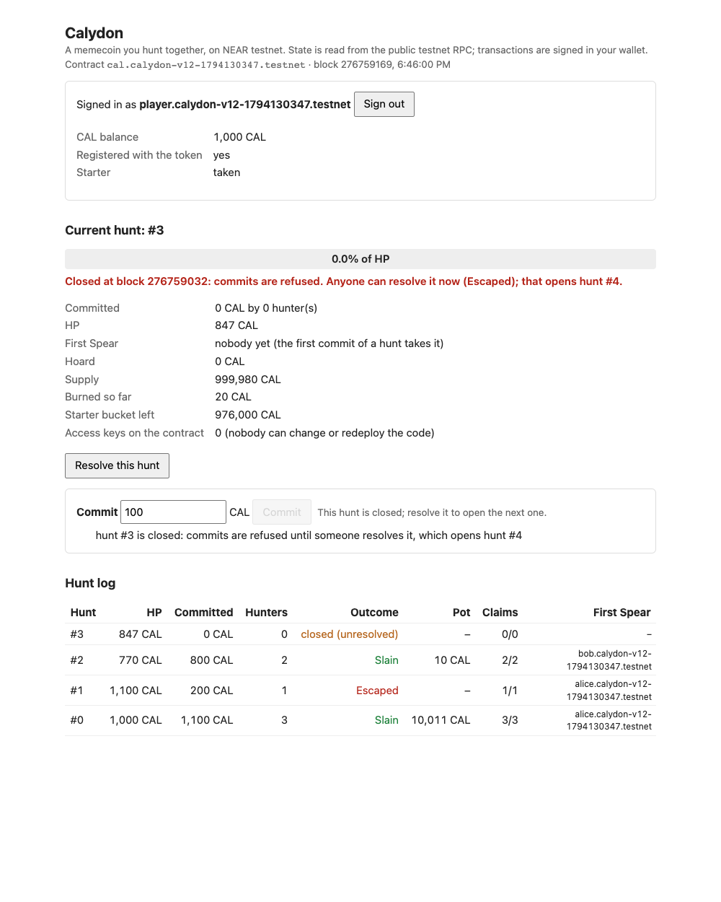
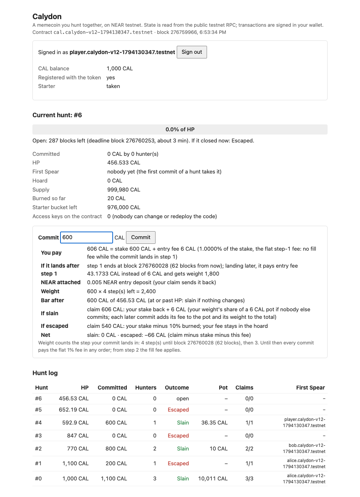

# Calydon

A memecoin you hunt together, on NEAR. Holders lock their own CAL against a beast's HP before a
deadline. If the total reaches the HP, the beast is slain and the hunters share the hoard. If it
falls short, the beast escapes with 10% of every stake, and that 10% burns.

Status: **v1.2.1, NEAR testnet only.** v1.2.1 changes only the page (below); the contract, `res/calydon.wasm`
and the testnet instance are those of v1.2. The v1.2 instance
[`cal.calydon-v12-1794130347.testnet`](https://testnet.nearblocks.io/address/cal.calydon-v12-1794130347.testnet)
was created, deployed and initialised in **one transaction** and has **never had an access key**, so
no transaction can be signed as that account and its code cannot be replaced. Its code hash equals
`res/calydon.wasm`, which `npm run verify:reproducible` rebuilds byte for byte from this repository.
`npm run observe-testnet` checks all of this without any key.

**v1.1 and v1.0 are superseded.** Their instances (`cal.calydon-v11-1794122775.testnet`, tag `v1.1`;
`cal.calydon-v1-1794114512.testnet`, tag `v1.0`) are immutable like every instance, so they keep
running their own code; their records moved to [testnet/v1.1/run.json](testnet/v1.1/run.json) and
[testnet/v1.0/run.json](testnet/v1.0/run.json) (`node scripts/observe-testnet.mjs testnet/v1.1/run.json`
still checks one). What v1.2 changes, each with its check:

| Change | Checked by |
|---|---|
| `ft_transfer` / `ft_transfer_call` whose receiver is the contract itself are refused (`RECEIVER_IS_CONTRACT`), and `resolve` no longer sweeps. In v1.1 an `ft_transfer_call` to the contract that was refunded after a `resolve` had swept it made the next `resolve` fail, so the game would halt; reproduced in sandbox against the v1.1 wasm ([VERIFY.md §A](VERIFY.md#v1_2_storage_starter_transfers-storage-deposits-the-starter-bucket-and-its-per-hunt-cap-transfers-to-the-contract-first-spear-launch-values-starters_per_hunt-2), [docs/journey.md](docs/journey.md)) | `npm run verify`, `v1_2_storage_starter_transfers` claim 4; testnet hunt 1 (two refused transfers); `tests/repro_v11.rs` for v1.1 |
| Every commit in a hunt's step 1 pays the flat 1% fee, in any order; the rising fill fee applies from step 2 | `launch_values` claim 3; testnet hunts 0–2 (all step 1); the browser session (a step-2 commit) |
| At most 20 starters per hunt (`starters_per_hunt`, reset when a hunt opens) | `v1_2_storage_starter_transfers` claim 1; `config()` |
| The page shows "closed (unresolved)" for a hunt past its deadline that nobody resolved yet, the step-1 fee and what a commit pays if it lands after step 1, and starters left this hunt | §3; [docs/browser/](docs/browser/) |
| Simulation re-run on the v1.2 wasm: 5 launch seeds and a replicator run; whale count for small populations; no NaN for an empty strategy; the replicator writes its summary every generation | §5; MECHANIC.md §3 |

**v1.2.1 (page only, no new instance).** The page now opens on the hunt itself: the boar of the
current hunt with its health going down as commits land (HP minus committed), the time left and the
step a commit lands in, every hunter of the hunt with stake, weight and share of the total weight
(First Spear marked), the hoard, and a three-step "how a hunt works" strip; the full numbers sit
behind a "Numbers and contract" toggle. The hunt log works out "open" or "closed (unresolved)" from
the latest block for every row, the current hunt included (v1.2 could leave a closed hunt shown as
"open", or an empty resolved hunt as "closed (unresolved)", when an RPC read failed or a row had been
cached). The hunter list and your entries come from one `view_state` read of the contract's entry
records instead of one `entry` call per hunt, so the page makes fewer RPC calls.

Carried over from v1.1: storage deposits for every record (an entry's is returned by its claim), the
starter bucket, one-transaction init, First Spear, the browser page with Intear Wallet, the exact
simulation oracle ([testnet/v1.1/run.json](testnet/v1.1/run.json), tag `v1.1`).

Every claim below comes with the command that checks it and the output it printed for us.
[VERIFY.md](VERIFY.md) lists each claim → command → expected output. The design, the simulation
tables and the limits are in [MECHANIC.md](MECHANIC.md).

## The rules (launch values, fixed at `new`, readable through `config()`)

| | |
|---|---|
| `starter()` | Once per registered account: 1,000 CAL from the starter bucket (980,000 CAL at launch), attaching 0.005 NEAR; at most 20 starters per hunt (the count resets when the next hunt opens). Demo-level: the cap paces distribution, and more accounts still get more starters over time. |
| `commit(amount)` | Locks your own CAL (at least 1 CAL) in the current hunt. The entry fee is paid on top and goes into the hoard. In step 1 (the hunt's first quarter) every commit pays a flat 1%, in any order. From step 2 on it is 1% for a token that goes into an empty bar, rising linearly to 11% for a token that goes into a full bar (and 11% past the HP); the fee is that rate integrated over the fill your stake covers. Your first commit to a hunt attaches 0.005 NEAR (the entry's storage, returned by your claim), a later one 1 yoctoNEAR. The hunt's first committer is its First Spear. |
| Reward rule B | A commit's weight is stake × the number of steps left before the deadline (4 steps per hunt on testnet). |
| `resolve(hunt)` | Anyone, once, after the deadline, attaching 0.005 NEAR (it stores the next hunt). Slain if committed ≥ HP. |
| `claim(hunt)` | Once per hunter. Slain: stake + hoard × weight / total weight, rounded down. Escaped: stake − 10% (the 10% burns, rounded up); the hoard rolls over. Sends the entry's 0.005 NEAR back. |
| Next HP | ×1.1 after a kill, ×0.7 after an escape (equilibrium kill rate ≈ 79%). A hunt nobody joins is an escape, so the HP keeps shrinking (×0.7 each) until someone can fill it. |
| Supply | Minted once at `new` (testnet: holder 10,000, launch hoard 10,000, starter bucket 980,000 CAL); it only falls, by escape burns. `ft_transfer` / `ft_transfer_call` are plain NEP-141 with no fee; a transfer whose receiver is the contract itself is refused (CAL reaches it only through `commit`). |
| Admin | None: no owner, setter, pause or upgrade method. The views are `config`, `current_hunt`, `hunt`, `entry`, `totals`, `starter_taken`. |

Why each rule exists, and the problem the rising entry fee answers: [MECHANIC.md §1–2](MECHANIC.md).

## 1. Check the contract in one command → see every claim `HELD`

Prerequisites. Both paths below were run for this repository: macOS on Apple Silicon, and a clean
`ubuntu:24.04` container following exactly these lines (2026-11-08 19:09–19:17 KST, commit `f542e59`, arm64, Node 18.19.1: the clone was copied in
because the repository is private; `npm run verify` took 3 min 10 s including the first build and
printed 23 claims held, and `npm run observe-testnet` printed `All 5 checks hold` for the v1.2 instance).

- **Debian/Ubuntu** (as root, or with `sudo`):
  ```sh
  apt-get update && apt-get install -y build-essential pkg-config libssl-dev curl ca-certificates git nodejs npm
  set -o pipefail   # bash: a failed download now fails the next line instead of running an empty script
  curl --proto '=https' --tlsv1.2 -sSf https://sh.rustup.rs | sh -s -- -y --profile minimal
  . "$HOME/.cargo/env"
  ```
  `ca-certificates` is needed for the HTTPS downloads (rustup, crates, the sandbox binary); a minimal
  image does not have it. Ubuntu 24.04's `nodejs` is 18.x, which is enough.
- **macOS**: the Xcode command line tools, `brew install pkg-config openssl node`, and rustup as above.
- `rust-toolchain.toml` makes rustup fetch Rust 1.99.1 and the wasm target on first use.
- No npm dependencies, no Docker, account, key or paid API. Docker is needed only for
  `npm run verify:reproducible` (§6), and it must run on a Docker host, not inside the container above.

```sh
git clone https://github.com/ianlyoo/calydon.git
cd calydon
npm run verify
```

`npm run verify` is `cargo test --locked -- --nocapture --test-threads=1`. It runs the unit tests
(including a 20,000-case property test for splitting) and then starts a local NEAR sandbox, deploys
the committed `res/calydon.wasm` (the bytes deployed on testnet) and asserts every claim on
contract state, balances and execution outcomes, checking conservation (I1) after every step. The
first run downloads the crates and the sandbox binary. Nothing in it touches testnet.

Expected output (abridged; from the macOS run of the release commit):

```text
test tests::fill_fees ... ok
test tests::m2_counterexample_is_the_safe_direction ... ok
test tests::rounding_helpers ... ok
test tests::splitting_never_pays_more ... ok
test result: ok. 4 passed; 0 failed; 0 ignored; 0 measured; 0 filtered out; finished in 0.22s

test v11_self_transfer_halts_resolve ... ignored
test execute_testnet ... ignored, uses NEAR testnet and the faucet; run with `npm run execute-testnet`

test launch_values ... HELD  1  launch values are fixed at init and readable: rule B, tribute 1% (flat in step 1), fill fee up to +10% from step 2, burn 10%, HP x1.1 / x0.7, 20 starters per hunt
HELD  2  refused commits change nothing: below the 1-CAL minimum stake, a new entry without its storage deposit, stake + fee above the balance
HELD  3  step 1 has one flat fee, whatever order commits land in; from step 2 the entry fee rises with the bar's fill; fees go into the hoard; rule B weights a commit by the steps left
         observed: step 1: alice 600 into an empty bar: fee 6 CAL (1%); dave 100 into a bar 60% full: fee 1 CAL (1%); step 3: bob 500 at 700/1000: fee 50.5 CAL (300 at 1% + 10% x 0.85, 200 past HP at 11%); weights 600x4, 100x4, 500x2; hoard 1000 + 57.5 = 1057.5 CAL
...
Calydon verify (launch values: flat step 1, fill fee from step 2, rule B, HP x1.1/x0.7): 7 claims held, 0 broken.
ok
test rule_a_hunts ... HELD  1  every parameter is fixed at init and readable; the wasm exports no setter, admin or pause method (I4; contract_source_metadata is the sdk's read-only NEP-330 view); create + deploy + new is one transaction and the contract account has no access key
...
Calydon verify (rule A, arithmetic-test values: no fill fee, HP x1.25/x0.8): 9 claims held, 0 broken.
ok
test rule_b_and_splitting ... HELD  1  rule B: no cap; the hoard is shared by stake x steps left, so an earlier commit earns more per token
HELD  2  I3 on chain: splitting a stake of 2 into 1 + 1 does not pay more (shares round down, tributes round up)
Calydon verify (rule B and splitting, arithmetic-test values): 2 claims held, 0 broken.
ok
test v1_2_storage_starter_transfers ... HELD  1  starter(): a registered account takes 1,000 CAL once from the starter bucket, at most starters_per_hunt (here 2) per hunt
HELD  2  storage: a commit that creates an entry must attach the entry deposit (5 mNEAR), a later commit to the same entry 1 yocto; the contract's free NEAR does not fall
HELD  3  the halt scenario: storage growth that the attached NEAR does not cover is refused, so commits cannot spend the contract's own NEAR
HELD  4  transfers to the contract itself are refused, so held == hoard + locked + unclaimed + starter bucket always; the v1.1 race (ft_transfer_call to the contract, resolve before its refund) cannot happen; the starter count starts again in a new hunt
         observed: ft_transfer 77 CAL to the contract: panic RECEIVER_IS_CONTRACT; ft_transfer_call 500 CAL to the contract: panic RECEIVER_IS_CONTRACT; resolve(0) one block later: Slain, pot = hoard 1000850000000000000000 (nothing swept), held == parts; resolve(1): Escaped; resolve without the record deposit: panic ATTACH_RECORD_DEPOSIT; in hunt 2 carol got the last 500 CAL; dave: panic STARTER_EMPTY
HELD  5  claim pays the CAL and sends the 5 mNEAR entry deposit back; First Spear of hunt 0 is alice, the first to commit
Calydon verify (storage, starter, transfers): 5 claims held, 0 broken.
ok

test result: ok. 4 passed; 0 failed; 0 ignored; 0 measured; 0 filtered out; finished in 107.24s
```

`rule_a_hunts` and `rule_b_and_splitting` run the same wasm with arithmetic-test values (no fill fee,
HP ×1.25 / ×0.8) so each payout can be checked by hand; `launch_values` and
`v1_2_storage_starter_transfers` run the launch values. The full list of claims and their `observed:`
lines: [VERIFY.md §A](VERIFY.md#a-npm-run-verify-local-sandbox-no-account-or-key).

## 2. Check the live testnet instance → see `All 5 checks hold`

```sh
npm run observe-testnet
```

Read-only, Node only, no key. It reads [testnet/run.json](testnet/run.json) (the recorded v1.2 run)
and asks the public testnet RPC. Output on 2026-11-08 18:42 KST, right after the run (the latest hunt
is open or waiting to be resolved whenever you run it; anyone may resolve it, and hunts 4 and 6 since
then are the browser session of §3):

```text
Calydon v1.2 on NEAR testnet: cal.calydon-v12-1794130347.testnet

OK    deployed code = res/calydon.wasm (the reproducible build; rebuild it with npm run verify:reproducible)
      chain code_hash 5GuUinESoDknp1ge6t5jTRno2yioVtif8DR5UQBJUgGP; res/calydon.wasm sha256 3f81cbfd5022cd46d1dde89019914b958c449f68646f1525f0592d9deff4e3c0
      NEP-330 on chain: git+https://github.com/ianlyoo/calydon?rev=008c805eecc1382e5743577bd2fd746354463e40, image docker.io/library/rust:1.99.1-slim-bookworm
OK    the contract account was created, deployed and initialised in one transaction with no key, and has 0 access keys now (no redeploy, no admin call)
      init tx AaW9hPJHJVAEDzr48EyY4bSPvgm8KgL3VyNcM9w9k6pm actions: CreateAccount, Transfer, DeployContract, FunctionCall(new); view_access_key_list: 0 keys
OK    config() = the launch values recorded at init
      rule EarlyWeight, tribute 100 bps + fill fee up to 1000 bps, burn 1000 bps, HP x1.1 slain / x0.7 escaped, hunts of 300 blocks, fill fee from step 2 of 75 blocks, 20 starters per hunt
OK    all 22 recorded transactions succeeded on chain with the recorded return values; the 2 recorded as refused failed with the recorded error
      22 of 22, e.g. https://testnet.nearblocks.io/txns/941WAYTfqiQkdAvETDQpMpekyu3HnhB8dhESgi2bBPxU
      refused: hunt 1: holder ft_transfer 50 CAL to the contract: RECEIVER_IS_CONTRACT, https://testnet.nearblocks.io/txns/5ry7JrkVZe4eoqwHSuaVX2qAy2dnEMqbeg4Gywh9ycYd
      refused: hunt 1: holder ft_transfer_call 50 CAL to the contract: RECEIVER_IS_CONTRACT, https://testnet.nearblocks.io/txns/Hr4YDos6J46qwVmaBJgv4kALsZzAmAaztPLfZpFfdgge
OK    totals: held = hoard + locked + unclaimed + starter bucket; supply + burned = launched
      supply 999980 CAL, burned 20, hoard 0.000000, locked 0, unclaimed 0, starter bucket 977000; held 977000.000000

Hunt log:
  hunt 0: HP 1000 CAL, committed 1100 by 3, Slain, pot 10011 CAL, claims 3/3, First Spear alice.calydon-v12-1794130347.testnet
  hunt 1: HP 1100 CAL, committed 200 by 1, Escaped, claims 1/1, First Spear alice.calydon-v12-1794130347.testnet
  hunt 2: HP 770 CAL, committed 800 by 2, Slain, pot 10.000000 CAL, claims 2/2, First Spear bob.calydon-v12-1794130347.testnet
  hunt 3: HP 847 CAL, committed 0 by 0, open, 245 blocks left, claims 0/0

All 5 checks hold.
```

The scripts try the public FastNEAR archival RPC, then
`test.rpc.fastnear.com`, then `archival-rpc.testnet.near.org`; `CALYDON_TESTNET_RPC=<url>` replaces
that list (and the RPC of the CLI, whose default is `https://test.rpc.fastnear.com`).

### The recorded testnet run

`npm run execute-testnet` produced [testnet/run.json](testnet/run.json) on 2026-11-08 (18:32–18:42 KST):
a fresh faucet account `calydon-v12-1794130347.testnet` is the launch holder (10,000 CAL),
`cal.<it>` runs the contract, and three hunters register and take their starters. Each fee and
payout was checked against the contract's arithmetic (`fill_fee`, `share`) before it was recorded,
and each refused call was checked to fail with the recorded error.

| Step | Returned | Transaction |
|---|---|---|
| create + deploy + `new` in one transaction | – | [AaW9hPJH…](https://testnet.nearblocks.io/txns/AaW9hPJHJVAEDzr48EyY4bSPvgm8KgL3VyNcM9w9k6pm) |
| storage_deposit alice.calydon-v12-1794130347.testnet | registered | [6p2QUnKw…](https://testnet.nearblocks.io/txns/6p2QUnKwBdEguMjqfhhxaJf6Z6jRHaGLgkpkxCRebPBb) |
| starter alice.calydon-v12-1794130347.testnet | 1,000 CAL | [4qYysLqm…](https://testnet.nearblocks.io/txns/4qYysLqmuMJaf51Z6iNAedTrKzZ48oTwLFgb7KWvkXER) |
| storage_deposit bob.calydon-v12-1794130347.testnet | registered | [Eakt4mcj…](https://testnet.nearblocks.io/txns/Eakt4mcjDPdCakbjaxvE957jtoEHK8JqF66Q99woHVdF) |
| starter bob.calydon-v12-1794130347.testnet | 1,000 CAL | [BHJXkanq…](https://testnet.nearblocks.io/txns/BHJXkanqc4S9zEWffpYj2uhM2LdTxs7gFt8cU4hx78h5) |
| storage_deposit carol.calydon-v12-1794130347.testnet | registered | [BNP47t4x…](https://testnet.nearblocks.io/txns/BNP47t4xVFcGRn8zcUb4Y2WNcXKKwA2onSbbqkoZwmAj) |
| starter carol.calydon-v12-1794130347.testnet | 1,000 CAL | [2s96Pe4B…](https://testnet.nearblocks.io/txns/2s96Pe4B2m38BrGnpkJF4sqmYpe47kZ33GTEn2PXqRDv) |
| hunt 0: alice commit 400 CAL (bar 0/1000 CAL, step 1, fee 4.0000 CAL) | 400 CAL locked | [BCrY8Fm2…](https://testnet.nearblocks.io/txns/BCrY8Fm2HSaubENV6QSG7sj1PhEF5ZgedFRN5dfDmZYn) |
| hunt 0: bob commit 300 CAL (bar 400/1000 CAL, step 1, fee 3.0000 CAL) | 300 CAL locked | [EV9Vp21J…](https://testnet.nearblocks.io/txns/EV9Vp21J9PWcpqHEXw9NPkE87vRvzfPve6Mo3XnzSvkW) |
| hunt 0: carol commit 400 CAL (bar 700/1000 CAL, step 1, fee 4.0000 CAL) | 400 CAL locked | [GgD5F8dR…](https://testnet.nearblocks.io/txns/GgD5F8dRSsg5omVyui4iEcw4R8GM4r1ZrNG38PxAp67o) |
| hunt 0: resolve | `Slain` | [941WAYTf…](https://testnet.nearblocks.io/txns/941WAYTfqiQkdAvETDQpMpekyu3HnhB8dhESgi2bBPxU) |
| hunt 0: alice claim | 4,040.363636… CAL | [6zstDU7X…](https://testnet.nearblocks.io/txns/6zstDU7XLNwf5bvpu8pYB2JMP2vCeuChtmhrFW2veB5U) |
| hunt 0: bob claim | 3,030.272727… CAL | [3KhUmKde…](https://testnet.nearblocks.io/txns/3KhUmKdepVVBJLZopC2TNektAiCEeZ1stYUXwvcFUmyR) |
| hunt 0: carol claim | 4,040.363636… CAL | [5zKA173M…](https://testnet.nearblocks.io/txns/5zKA173MZJYuBUzrhuQkLzSWBhgkGbPXcR4mzJN7WxqR) |
| hunt 1: alice commit 200 CAL (bar 0/1100 CAL, step 1, fee 2.0000 CAL) | 200 CAL locked | [GN8oXgyo…](https://testnet.nearblocks.io/txns/GN8oXgyoPvbZce7zujvN2gXnzeoL2fCfSjiYzVymiHMY) |
| hunt 1: holder ft_transfer 50 CAL to the contract | refused: `RECEIVER_IS_CONTRACT` | [5ry7JrkV…](https://testnet.nearblocks.io/txns/5ry7JrkVZe4eoqwHSuaVX2qAy2dnEMqbeg4Gywh9ycYd) |
| hunt 1: holder ft_transfer_call 50 CAL to the contract | refused: `RECEIVER_IS_CONTRACT` | [Hr4YDos6…](https://testnet.nearblocks.io/txns/Hr4YDos6J46qwVmaBJgv4kALsZzAmAaztPLfZpFfdgge) |
| hunt 1: resolve | `Escaped` | [CByFmeTF…](https://testnet.nearblocks.io/txns/CByFmeTF2tpoCthMWfJb7vXMnk2PEFb7XsWNC5LD42CE) |
| hunt 1: alice claim | 180 CAL | [6e5UqFHp…](https://testnet.nearblocks.io/txns/6e5UqFHpKedovvLZ9G1RLS9s5h9myLLPkEou7NYrodwc) |
| hunt 2: bob commit 500 CAL (bar 0/770 CAL, step 1, fee 5.0000 CAL) | 500 CAL locked | [BLDpmi7R…](https://testnet.nearblocks.io/txns/BLDpmi7RkEJ3jviZJECZMbGKdySpUaFu22BmpE32XBxe) |
| hunt 2: carol commit 300 CAL (bar 500/770 CAL, step 1, fee 3.0000 CAL) | 300 CAL locked | [2KsaeP2u…](https://testnet.nearblocks.io/txns/2KsaeP2uqEeUv6CepaKnenUuvm4gDbu8YtAjzQZK6PPE) |
| hunt 2: resolve | `Slain` | [4p1hZF7n…](https://testnet.nearblocks.io/txns/4p1hZF7nU9VJsgnaK1wDzf23t4WYgL8GMmetzyx4Dqmw) |
| hunt 2: bob claim | 506.25 CAL | [FQPehYuz…](https://testnet.nearblocks.io/txns/FQPehYuzV5he1vigPBpFgpbcymSJnRhetfYh5VQC9ZEr) |
| hunt 2: carol claim | 303.75 CAL | [9kawgmoQ…](https://testnet.nearblocks.io/txns/9kawgmoQ5tcBCmk6KQ22z7HZRmHqbxcpvG23RwcvR1xf) |

What the numbers show: every commit in this run landed in step 1, so each paid the flat 1% whatever
the fill: carol's 400 CAL into a bar already 70% full paid 4 CAL, the same as alice's 400 CAL into an
empty bar. All three landed in the same rule-B step, so their shares of the 10,011 CAL pot (launch
hoard 10,000 + 11 in fees) are pro rata. In hunt 1 the holder tried to send 50 CAL to the contract,
once with `ft_transfer` and once with `ft_transfer_call`; both were refused with
`RECEIVER_IS_CONTRACT`, and `totals` shows held = hoard + locked + unclaimed + starter bucket exactly.
Hunt 2's pot (10 CAL) is hunt 1's and hunt 2's fees. A step-2 commit, which pays the fill fee, is in
the browser session below.

## 3. Play in a browser → sign in, commit, resolve and claim from the page

```sh
npm run page
```

```text
Calydon page: http://127.0.0.1:8494/status/  (Ctrl-C to stop)
```

Open that address (`PORT=<n> npm run page` serves on another port). `status/` is a static page (HTML, one script, and the pinned wallet bundle in
`status/vendor/`); `npm run page` only serves it and `testnet/run.json` from this machine, and the
same files can be hosted as they are. Nothing is hosted by this repository. The page reads the
public testnet RPC every 4 seconds (older hunts with unclaimed entries about once a minute; after a failed read, often a rate limit, it waits up to 32 seconds); `?contract=<id>` shows another instance (for example one you
launched in §4) and `?rpc=<url>` uses another RPC.

**Wallet.** Sign-in uses NEAR wallet-selector 10.1.4 with the Intear Wallet module
(`@near-wallet-selector/intear-wallet`, pinned, bundled by `status/vendor-src/`). Any testnet account
works: create one in [Intear Wallet](https://wallet.intear.tech) or import one there by private key
or seed phrase. MyNearWallet is not offered: since 1 November 2026 it no longer connects to apps or
signs transactions. Every call that attaches NEAR (storage_deposit, starter, commit, resolve) opens a
wallet window to approve; so does claim.

**What the page shows first (v1.2.1):** the current hunt as a boar card: its health left (HP minus
committed) as a bar, the time left and which of the hunt's steps a commit lands in (so what it weighs),
every hunter of the hunt with stake, weight and share of the total weight, First Spear marked, and the
hoard. Below: how a hunt works in three steps, your hunts, the hunt log, and "Numbers and contract"
(committed, HP, total weight, supply, burned, unclaimed, starter bucket, access keys, contract).

**What the page does, signed in:** your CAL balance; a `storage_deposit` button until you are
registered; `Get starter CAL` until you took it; `Commit` with a live preview (the four main numbers
on the card, every row under "Full preview of this commit") of what you pay (stake
+ the exact entry fee: the flat 1% while the hunt is in step 1, otherwise integrated over the fill your
stake covers; during step 1 also what the commit pays and weighs if it lands after step 1, since a
wallet approval can take a minute), the NEAR attached, your weight
(stake × steps left), the bar after, and your claim if the hunt is slain or escaped as things stand;
`Resolve this hunt` once the deadline has passed; how many of this hunt's 20 starters are left; and *Your entries* with what each claim pays and a
`Claim` button. The deadline line says how many blocks are left, which step a commit lands in and
until which block, and turns red once commits are refused. Signed out, it shows the hunt, HP bar,
hoard, supply, burned CAL, the starter bucket, the access keys on the contract (0) and the hunt log
with each hunt's First Spear; a hunt past its deadline that nobody resolved yet shows as
"closed (unresolved)".

**One recorded session** ([docs/browser/](docs/browser/), 2026-11-08 18:43–18:54 KST, v1.2 instance, the v1.2 page before the v1.2.1 layout): a
fresh testnet account `player.calydon-v12-1794130347.testnet` (2 NEAR from the launch holder), imported
into Intear Wallet, signs in on the page, runs `storage_deposit`
([2po2EF9B…](https://testnet.nearblocks.io/txns/2po2EF9BfpdWJmzB7M6tguxvxMVcY6buS8gMeUGYL7N3)) and takes its starter
([6crvHApu…](https://testnet.nearblocks.io/txns/6crvHApuXr9ne9Jj377YiYrVnTw5Ybmedu1rX2tAhvTB)). Hunt 3 is past its deadline and
unresolved, so the hunt log shows it as "closed (unresolved)"; the account resolves it (empty,
`Escaped`; [HAoP3YhS…](https://testnet.nearblocks.io/txns/HAoP3YhSQ2ZeVnFFgZPqLy1vfBVHGXvkUEwxiYR6ic6S)) and commits 600 CAL into
hunt 4 ([JDRQT8bx…](https://testnet.nearblocks.io/txns/JDRQT8bxECcuchL8t2BUdVwyroXyc1pU721n7x56MZh)). The preview was taken in step 1
(41 blocks left in it: pay 606 CAL, weight 600 × 4); the wallet approval took longer than that, so the
commit landed in step 2 and paid the step-2 fee: 36.355 CAL (1% on all 600 = 6, plus 10% × the average fill 0.5
on the 592.9 CAL up to the HP = 29.645, plus 10% on the 7.1 CAL past it = 0.71), weight 600 × 3 = 1,800, as *Your entries* shows. After the deadline
it resolves hunt 4 (`Slain`, it is First Spear;
[DcxXr5Gt…](https://testnet.nearblocks.io/txns/DcxXr5GtduTMZ1MTg6Mea4qAP9PuHWEYTZwLAFdqeaJW)) and claims 636.355 CAL plus the 0.005
NEAR entry deposit back ([5QWQmVZc…](https://testnet.nearblocks.io/txns/5QWQmVZcEkWxnkVaLS2dNvKxz4TGvC4DH2LuUxkr8Byh)); its balance is
back to 1,000 CAL. The last screenshot is the preview at the start of hunt 6 (after resolving the
empty hunt 5, [BF4kkLaG…](https://testnet.nearblocks.io/txns/BF4kkLaGHBxQ1cmUpTufs5gFu9Unkj1FozeitdkeTqNH)), with the row the page
gained after this commit: what the same 600 CAL pays if it lands after step 1. Each step is a
screenshot of the page and of the wallet window, in order. It was driven by
`scripts/browser-session.mjs` (Playwright; not a dependency of this repository).

| Closed, not yet resolved | Commit preview in step 1 | Claimable |
|---|---|---|
|  |  |  |

## 4. Play on testnet from the command line → see your commit, the resolve and your claim as transactions

```sh
npm run hunt -- launch                     # your own instance, created like the v1.2 one
npm run hunt -- commit 600 --as alice
npm run hunt -- status
npm run hunt -- resolve                    # after the deadline; anyone may
npm run hunt -- claim 0 --as alice
npm run hunt -- starter --as <name>        # any account with a key file in .credentials/testnet/
```

`launch` creates a fresh account from the testnet faucet (free, no key or token of yours needed),
creates, deploys and initialises `cal.<it>` in one transaction with the launch values (so that
account never has a key), and creates two hunters, `alice` and `bob`, who register and take their
1,000-CAL starters. Their keys are random and saved under `.credentials/testnet/` (ignored by git;
never printed). A hunt lasts 600 blocks (about 6 minutes on testnet; `--hunt-blocks N` changes it).
Each command compiles once, then took us 30–55 seconds per call against the public RPC; a commit that
lands after the deadline is refused with `HUNT_CLOSED` and nothing moves. Without a `launch`, the
commands use the recorded v1.2 instance, where any account can take a starter and play (at most 20
starters per hunt).

Output from one session on 2026-11-08 (18:56–19:05 KST, v1.2 code), launched with `--hunt-blocks 200`:

```text
$ npm run hunt -- launch --hunt-blocks 200
launched cal.calydon-play-1794131780.testnet (no access key); holder calydon-play-1794131780.testnet; alice and bob took 1000-CAL starters
contract cal.calydon-play-1794131780.testnet (rule EarlyWeight, tribute 100 bps + fill fee up to 1000 bps, burn 1000 bps, HP x1.1 / x0.7)
hunt 0: [....................] 0 / 1000 CAL committed by 0 hunter(s)
  open: 173 blocks left (deadline 276760457); step 1 until block 276760307: every commit pays the flat 0.01 CAL per CAL fee, in any order
hoard 10000 CAL · supply 1000000 CAL · burned 0 CAL · unclaimed 0 CAL · starter bucket 978000 CAL

$ npm run hunt -- commit 600 --as alice
alice.calydon-play-1794131780.testnet committed 600 CAL
  https://testnet.nearblocks.io/txns/2NrrosN5vWkEWBaUuiG1CRKvxPH9rM1zEf7iK1hVan63
  locked 600 CAL
contract cal.calydon-play-1794131780.testnet (rule EarlyWeight, tribute 100 bps + fill fee up to 1000 bps, burn 1000 bps, HP x1.1 / x0.7)
hunt 0: [############........] 600 / 1000 CAL committed by 1 hunter(s)
  open: 165 blocks left (deadline 276760457); step 1 until block 276760307: every commit pays the flat 0.01 CAL per CAL fee, in any order
hoard 10006 CAL · supply 1000000 CAL · burned 0 CAL · unclaimed 0 CAL · starter bucket 978000 CAL

$ npm run hunt -- commit 500 --as bob
bob.calydon-play-1794131780.testnet committed 500 CAL
  https://testnet.nearblocks.io/txns/5T4pBgzoDvEqE9ag8aK3BDVstDZnysjCXeyreTMuP4gs
  locked 500 CAL
contract cal.calydon-play-1794131780.testnet (rule EarlyWeight, tribute 100 bps + fill fee up to 1000 bps, burn 1000 bps, HP x1.1 / x0.7)
hunt 0: [####################] 1100 / 1000 CAL committed by 2 hunter(s)
  open: 157 blocks left (deadline 276760457); step 1 until block 276760307: every commit pays the flat 0.01 CAL per CAL fee, in any order
hoard 10011 CAL · supply 1000000 CAL · burned 0 CAL · unclaimed 0 CAL · starter bucket 978000 CAL

$ npm run hunt -- status
contract cal.calydon-play-1794131780.testnet (rule EarlyWeight, tribute 100 bps + fill fee up to 1000 bps, burn 1000 bps, HP x1.1 / x0.7)
hunt 0: [####################] 1100 / 1000 CAL committed by 2 hunter(s)
  deadline 276760457 passed: `npm run hunt -- resolve` settles it (will be Slain)
hoard 10011 CAL · supply 1000000 CAL · burned 0 CAL · unclaimed 0 CAL · starter bucket 978000 CAL

$ npm run hunt -- resolve
hunt 0 resolved by calydon-play-1794131780.testnet
  https://testnet.nearblocks.io/txns/3EYEjc1g5xWz6xATEp3YKQnxEn3Kg2Ra85EehCwJ4xz2
  outcome "Slain"
contract cal.calydon-play-1794131780.testnet (rule EarlyWeight, tribute 100 bps + fill fee up to 1000 bps, burn 1000 bps, HP x1.1 / x0.7)
hunt 1: [....................] 0 / 1100 CAL committed by 0 hunter(s)
  open: 199 blocks left (deadline 276760678); step 1 until block 276760528: every commit pays the flat 0.01 CAL per CAL fee, in any order
hoard 0 CAL · supply 1000000 CAL · burned 0 CAL · unclaimed 11111 CAL · starter bucket 978000 CAL

$ npm run hunt -- claim 0 --as alice
alice.calydon-play-1794131780.testnet claimed hunt 0
  https://testnet.nearblocks.io/txns/9FXUg8Kfk8XnD4EATG4r1sS8HMD4Bt6NL2UTMqwBm6Vh
  paid 6060.545454545454545454 CAL; balance now 6454.545454545454545454 CAL

$ npm run hunt -- claim 0 --as bob
bob.calydon-play-1794131780.testnet claimed hunt 0
  https://testnet.nearblocks.io/txns/2U6YXFRzZ2K3EjGzeJGVVp8TT1uw3S978okQkNdn9cma
  paid 5050.454545454545454545 CAL; balance now 5545.454545454545454545 CAL
```

Both commits landed in step 1 (4 of 4 steps left), so each paid the flat 1% (6 and 5 CAL), although
bob's 500 CAL went into a bar already 60% full. The pot was the 10,000 CAL launch hoard plus those
fees, 10,011 CAL; with weights 600 × 4 = 2,400 and 500 × 4 = 2,000, alice got 600 + 10,011 × 2,400 /
4,400 and bob 500 + 10,011 × 2,000 / 4,400, rounded down. Each claim also sent back the
0.005 NEAR its first commit attached.

## 5. Re-run the simulation → see MECHANIC.md's tables

```sh
npm run simulate -- --seed 494     # about 17–18 minutes (three runs in parallel on an Apple Silicon Mac); writes sim/seed-494-hp300.json
npm run sim-tables                 # prints MECHANIC.md §3's tables from the files in sim/
npm run sim-converge               # 10 generations of 20 hunts whose strategy mix follows the money (about 35 minutes)
```

300 hunters with seven fixed strategies play 60 hunts against the committed `res/calydon.wasm` in a
local sandbox, once under rule B (launch) and once under rule A for comparison. Every commit's fill,
integrated fee, steps left and weight, every hunt's outcome, pot and next HP, every claim's payout and
every final balance is compared with an independent computation in `examples/simulate.rs`
(big-integer arithmetic written separately from the contract's); the run stops on any difference.
Output of the run committed in `sim/`:

```text
Calydon simulation (v1.2): seed 494, 300 hunters, 60 hunts, first HP 3% of supply, HP x1.1/x0.7, burn 10%, launch hoard 1%, wasm 3f81cbfd5022cd46d1dde89019914b958c449f68646f1525f0592d9deff4e3c0

Rule B (early-commit weighting, launch rule): kill rate 81.67% (49/60), supply 100000000 -> 96044868 CAL
  strategy                     hunters  joins  net % start  net/100 stk   supply share
  early committer                   95   3709        11.8%         1.26         16.41%
  threshold watcher                 95   5057      -59.43%         -7.3        -57.76%
  quitter                           48   1294        3.01%         0.49          7.26%
  first mover (round 1, lands first)      47   1784       11.22%         1.28          15.8%
  late whale (wait-and-fill)         7     14       -9.71%        -7.77         -5.99%
  solo whale                         4     26       22.34%          2.7         27.38%
  split whale                        4      8        6.36%         2.81         10.74%

Rule A (HP cap): kill rate 81.67% (49/60), supply 100000000 -> 96125331 CAL
...
Written: sim/seed-494-hp300.json (1015.453786875s)
```

The *first mover* is the best response named in the v1.1 brief ("commit in round 1 as early as
possible"): its round-1 commits are sent before everyone else's, so they land first. On v1.1 it was on
top in every launch cell; on v1.2, where every round-1 (step-1) commit pays the same flat 1%, it was
above the early committers in 1 of 5 seeds and on top in none, while a solo whale that fills the HP in
round 1 was on top in 3 of 5. MECHANIC.md §3.1 has the 5 seeds with mean ± sd, §3.2 what the strategy
mix converges to when each generation's mix follows the previous generation's results, and §5 the
limits.

A re-run gives different numbers: inside a round the commits are sent together, the sandbox picks
the order they land in (first movers' commits are sent first), and from step 2 on the fee depends on
that order. Other options: `--hp0-bps`, `--burn-bps`, `--hoard-bps`, `--hunters`, `--hunts`, `--mix`,
`--set fill_fee_bps=0` (the same wasm without the fill fee), `--out <file>`.

## 6. Rebuild the wasm → see the same bytes as on testnet

```sh
npm run verify:reproducible
```

Needs Docker. It reads the source commit named inside `res/calydon.wasm` (NEP-330), builds that
commit with `git archive` in the pinned image
`docker.io/library/rust:1.99.1-slim-bookworm@sha256:392f2219…` (linux/amd64; on an arm64 host Docker
emulates it and the build runs one job at a time: 5–8 minutes on an Apple Silicon Mac), and
compares the result with `res/calydon.wasm`, `res/calydon.wasm.sha256` and the code hash deployed on
testnet. On Apple Silicon the emulated build crashed once in five one-job runs (`linking with cc failed:
signal: 11 (SIGSEGV)`, an emulator crash, not a byte difference); running it again passed. Expected
output:

```text
building commit 008c805eecc1382e5743577bd2fd746354463e40 in docker.io/library/rust:1.99.1-slim-bookworm@sha256:392f221964669402bf4ae133d2a46c3ae270f64734133f4b2703d40019235c1a with CARGO_BUILD_JOBS=1
...
    Finished `release` profile [optimized] target(s) in 4m 46s
3f81cbfd5022cd46d1dde89019914b958c449f68646f1525f0592d9deff4e3c0  .../target/reproducible/calydon.wasm
OK    rebuilt from commit 008c805eecc1382e5743577bd2fd746354463e40: byte-identical to res/calydon.wasm
      sha256 3f81cbfd5022cd46d1dde89019914b958c449f68646f1525f0592d9deff4e3c0 vs 3f81cbfd5022cd46d1dde89019914b958c449f68646f1525f0592d9deff4e3c0
OK    equals res/calydon.wasm.sha256
      3f81cbfd5022cd46d1dde89019914b958c449f68646f1525f0592d9deff4e3c0
OK    equals the code deployed on testnet at cal.calydon-v12-1794130347.testnet
      chain code_hash 5GuUinESoDknp1ge6t5jTRno2yioVtif8DR5UQBJUgGP, rebuilt 5GuUinESoDknp1ge6t5jTRno2yioVtif8DR5UQBJUgGP

Source, committed wasm and deployed code are the same bytes.
```

## Layout

| Path | What |
|---|---|
| `src/lib.rs` | The contract: NEP-141 + NEP-145 (near-contract-standards), `starter` / `commit` / `resolve` / `claim`, the views, NEP-297 events. Pure arithmetic (`fill_fee`, `share`, `ceil_bps`, `floor_bps`) is public for the tests. |
| `src/tests.rs` | Unit tests, including the 20,000-case splitting property test. |
| `tests/verify.rs` | `npm run verify`: sandbox scenarios against `res/calydon.wasm`. |
| `tests/testnet.rs` | `npm run execute-testnet`: the recorded testnet run. |
| `tests/repro_v11.rs` | The v1.1 accounting gap reproduced against the v1.1 wasm (ignored; command in VERIFY.md §A). |
| `tests/common/mod.rs` | Shared helpers; `launch_config()` is the one place the launch values are written; `deploy()` is the one-transaction create + deploy + `new`. |
| `examples/simulate.rs` | `npm run simulate`, with its independent oracle (`oracle_fee`, `oracle_share`, `oracle_burn`). |
| `examples/hunt.rs` | `npm run hunt`. |
| `status/` | The page: `index.html`, `app.js`, `vendor/wallet-selector.js` (the pinned wallet-selector bundle) and `vendor-src/` (how that bundle is built: `npm ci --ignore-scripts && npm run bundle` there). |
| `scripts/` | Reproducible build, `observe-testnet`, `sim-tables`, `sim-converge`, the page server, `browser-session.mjs` (how `docs/browser/` was recorded), RPC helpers. |
| `res/calydon.wasm` | The reproducible build deployed on testnet, and its sha256. |
| `sim/` | Committed simulation results (`sim/converge/`: the replicator generations). |
| `testnet/run.json`, `testnet/v1.1/run.json`, `testnet/v1.0/run.json` | The v1.2 record and the superseded v1.1 and v1.0 records. |
| `docs/browser/` | The browser session, one screenshot per step. |
| `docs/journey.md` | Dated decisions. `docs/day1*.md`: the overnight measurements (Korean). |

Libraries: near-sdk 5.30.1 and near-contract-standards 5.30.1 (contract); near-workspaces 0.24.0
(sandbox and testnet in the tests, the simulator and the CLI); for the page only,
@near-wallet-selector/core and @near-wallet-selector/intear-wallet 10.1.4, bundled into
`status/vendor/`. The read-only scripts use Node's standard library only.

## Limits

The watcher strategy loses by design; a whale that fills the whole HP in step 1 is not priced out, and
the flat step-1 fee made that cheaper (a solo whale was on top in 3 of 5 simulated launch seeds); the
simulated strategies are fixed rules; re-runs vary and MECHANIC.md §3.1 has 5 seeds, not 10; the starter is
demo-level (20 per hunt paces it; more accounts still get more starters over time); the splitting statements are integer arithmetic about stakes, not about who owns which
account; nothing here says anything about fun or
price. Details: [MECHANIC.md §5](MECHANIC.md#5-limits-stated-plainly). CAL exists on testnet only.

## How this was built

The code, tests, scripts and documents in this repository were written by an AI coding agent
(Claude, by Anthropic) working under the owner's direction; the owner chose the design and the
launch values ([docs/journey.md](docs/journey.md)). The test harness pattern (claims printed as
`HELD` only after they are asserted), the pinned reproducible build and the read-only observer
follow the owner's earlier project Préavis (github.com/ianlyoo/preavis): `scripts/near-rpc.mjs` is
copied from it, and `scripts/build-reproducible.sh` and `scripts/verify-reproducible.mjs` are adapted
from it. No contract code is shared.

## License

[MIT](LICENSE).
